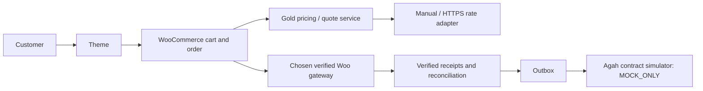

# Gold Commerce — architecture and G0 decisions

Specification baseline: development package 1.1.0 dated 2026-11-09. The ten document hashes were verified before implementation. The proprietary Agah ZIP is read-only, excluded from every deliverable, SHA256 `9ff291994e673133a762f305c15b8d11b78f3f22667634c964c530360827aa9c`.

Three independently installable packages share no runtime database across stores:

* `gold-commerce-theme`: presentation, local assets, Customizer, selective refresh, accessibility controls. It never calculates or persists financial prices.
* `gold-commerce-core`: exact arithmetic, product models, rate providers, quote lifecycle, receipts, notifications, reporting, customer services and Woo integration.
* `gold-agah-connector`: proposed contract, persistent simulator, scoped mappings, durable outbox/inbox, retries and HMAC ingress. Explicitly `MOCK_ONLY`.

WooCommerce owns products, variations, carts, customers, orders, payments and refunds. Orders use WC CRUD and HPOS. Custom SQL targets Gold tables and Woo's documented held-stock table only; no direct order-post storage queries appear in application code.

## ADRs

1. Each installation receives a random store UUID, separate DB/options/credentials and independent branding. No Multisite, shared operational data or hardcoded commercial commission.
2. Gold arithmetic uses decimal strings and arbitrary-length intermediate integer arithmetic. Weights have four decimal places; component amounts round once to integer IRR according to the selected policy. Woo currency must be IRR; optional IRT display divides by ten without floats. Gold item tax is included in its component snapshot and Woo product tax is `none`, preventing double collection. Shipping tax remains explicit in the order snapshot. Fixtures contain fictional tax values, never a production recommendation.
3. A quote commits a price for its own TTL. Rate freshness, quote validity and gateway grace are separate. Public price recalculation never rewrites an issued snapshot. Cart changes require explicit customer confirmation; a further change during checkout is rejected.
4. Issued quotes use Woo `pending` order status so native held-stock queries count their reservations. The separate quote table distinguishes `issued`, `payment_started`, `paid`, `superseded`, `expired`, `failed`, `payment_review`. One order advisory lock serializes issue/start/settle; Woo native InnoDB reservations enforce cross-order availability. Reissuing a sufficiently covered hold reuses it rather than misinterpreting an unchanged SQL update as no stock.
5. Payment URLs perform no state changes on GET, including email-scanner visits. A nonce-protected POST consumes the token and creates one intent. Tokens are random 256-bit values, hashed in quote storage. Guest ownership uses a separate capability token; payment tokens are not general account credentials.
6. An append-only receipt ledger records verified money before order reconciliation. Amount/intent/time mismatch becomes review, not paid. Gateway adapters must verify their provider server-to-server and pass the actually verified IRR amount. The included gateway moves no funds and is unavailable in production environments. An arbitrary installed gateway is not automatically certified.
7. The tested checkout path is classic Woo shortcodes. Blocks checkout for Gold is denied. Converting existing pages requires an explicit administrator action and saves their previous content. Activation preserves existing pages and privacy content.
8. A persistent MU financial guard is installed with Core. If Core is deactivated, specialized products and quote payments fail closed, including after a theme change. Deactivation never deletes financial data.
9. No public API supporting the required operations was found in supplied Agah alpha12. No Agah files are extracted into source, edited, loaded or repackaged. Mock data can never become real inventory authority. `agah_connected` configuration degrades safely until a separately implemented, verified live adapter is delivered. Returning to standalone requires controlled reconciliation; disabling Connector does not silently promote cached Woo stock.
10. No external font, tracking or social API is mandatory. Customer files and brand materials remain owner inputs. The illustration is a bundled decorative SVG; all sample goods are fictional. PDF rendering includes licensed TCPDF/DejaVu fonts, distinct from the owner's storefront WOFF2.

See TEST_REPORT for exact tested versions, evidence, unresolved checks and external inputs. Gates are quality controls for one product; no gate is marked passed solely because files exist.
